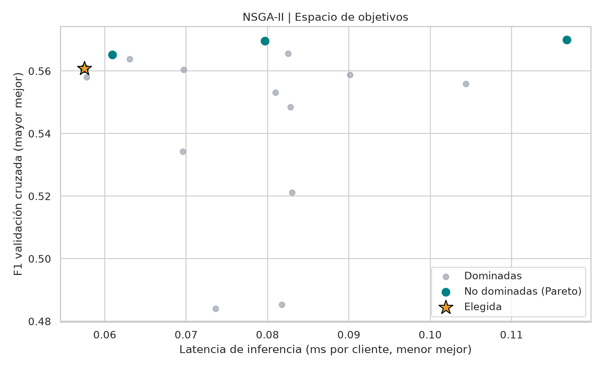

# RetenIA

**Inteligencia predictiva para retener clientes.**

RetenIA es una plataforma de análisis de abandono de clientes (*customer churn*) que transforma datos comerciales en estimaciones de riesgo, explicaciones interpretables y escenarios de priorización. Su interfaz interactiva permite explorar una cartera, evaluar perfiles individuales y orientar decisiones de retención con evidencia cuantitativa.

**Enfoque:** telecomunicaciones · **Aplicación:** Streamlit · **Idioma:** español

---

## Qué ofrece RetenIA

| Capacidad | Valor para el negocio |
| --- | --- |
| **Análisis de cartera** | Segmentación por contrato, antigüedad, servicios y facturación, con indicadores y filtros interactivos. |
| **Predicción de abandono** | Estimación de la probabilidad de baja de un cliente a partir de su perfil. |
| **Evaluación de modelos** | Comparación de calidad predictiva, errores de clasificación y curvas ROC y Precision–Recall. |
| **Optimización inteligente** | Comparación de Grid Search, Random Search y Hyperband; análisis multiobjetivo con NSGA-II. |
| **Explainable AI** | Interpretación global y local de predicciones mediante SHAP, LIME y Feature Importance. |
| **Planificación comercial** | Priorización de contactos y simulación de campañas con presupuesto y supuestos ajustables. |

## Plataforma

La aplicación organiza el trabajo en nueve módulos: **Inicio**, **Exploratory Data Analysis**, **Model Performance**, **Hyperparameter Optimization**, **NSGA-II · Pareto Frontier**, **Explainable AI · SHAP y LIME**, **Prediction & Explainability**, **Business Application** e **Información del servicio**.

Los modelos y resultados se cargan desde artefactos previamente generados. **La aplicación no reentrena modelos durante su uso.**

## Rendimiento predictivo

La evaluación se realiza sobre **1.409 clientes reservados para prueba**, separados del proceso de selección y optimización.

| Modelo | F1-score | ROC-AUC | Recall |
| --- | ---: | ---: | ---: |
| Logistic Regression | 0,604 | 0,842 | 0,559 |
| Random Forest (base) | 0,553 | 0,818 | 0,505 |
| Random Forest seleccionado mediante NSGA-II | 0,581 | 0,830 | 0,535 |

La solución seleccionada mediante **NSGA-II** considera conjuntamente el F1-score de validación cruzada y el tiempo de inferencia. **Logistic Regression obtuvo un F1-score superior en test**; esa diferencia se conserva explícitamente para una evaluación objetiva de alternativas. La latencia depende del entorno de ejecución.



## Diseño técnico

El flujo de análisis sigue cinco etapas:

1. **Preparación de datos:** validación del esquema, tratamiento de `TotalCharges` y exclusión del identificador como predictor.
2. **Preprocesamiento reproducible:** `ColumnTransformer` y `Pipeline` con escalado numérico y codificación One-Hot.
3. **Validación:** partición estratificada 80/20 y validación cruzada estratificada de tres particiones dentro de entrenamiento.
4. **Optimización:** Grid Search, Random Search, Hyperband (Optuna) y NSGA-II para explorar el compromiso entre calidad y latencia.
5. **Interpretabilidad:** SHAP, LIME y Feature Importance para comprender las predicciones sin atribuirles causalidad.

**Datos de referencia:** [Telco Customer Churn](https://www.kaggle.com/datasets/blastchar/telco-customer-churn), con 7.043 registros y 19 variables predictoras. Se trata de un conjunto de demostración; no representa una integración con datos operativos de una empresa.

## Ejecutar localmente

Requisitos: Python, Git y un entorno virtual. Los modelos entrenados y el conjunto de datos de demostración están incluidos en el repositorio.

```bash
git clone git@github.com:KevinErazo-11/RetenIA-Customer-Churn.git
cd RetenIA-Customer-Churn
python3 -m venv .venv
source .venv/bin/activate
python -m pip install -r requirements.txt
python -m streamlit run app.py
```

Abrir `http://localhost:8501` en el navegador.

## Estructura del repositorio

```text
app.py                   Plataforma interactiva
src/                     Preparación de datos, optimización y lógica comercial
artifacts/               Pipelines entrenados, métricas y explicaciones
figures/                 Visualizaciones de evaluación
notebooks/               Análisis exploratorio y experimentación reproducible
data/                    Dataset de demostración
tests/                   Pruebas automatizadas
requirements.txt         Dependencias del entorno
```

Los experimentos pueden regenerarse con `python run_experiments.py`. Este proceso vuelve a entrenar modelos y puede producir diferencias en la selección basada en latencia; no es necesario para utilizar la aplicación con los artefactos incluidos.

## Alcance y uso responsable

RetenIA es una **demostración funcional de analítica predictiva**, no un sistema validado para decisiones automáticas en producción. Las probabilidades indican asociaciones estadísticas; SHAP y LIME no prueban relaciones causales. Los costos, tasas de respuesta y retornos de las simulaciones son **supuestos hipotéticos**, no resultados comerciales observados. Antes de su adopción operativa se requieren validación con datos reales, revisión de privacidad, monitoreo de desempeño y pruebas controladas de campañas.

---

**RetenIA — Datos comprensibles. Riesgos visibles. Decisiones mejor fundamentadas.**
